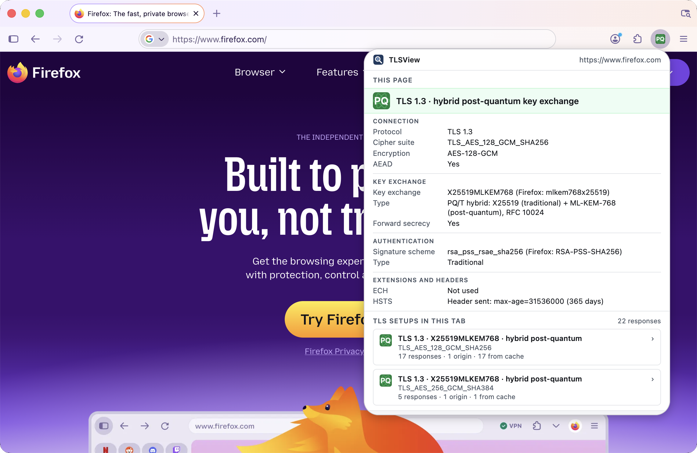

# TLSView

Firefox extension for checking post-quantum (PQC) readiness of TLS connections: it rates each site's key exchange as traditional, hybrid post-quantum or pure ML-KEM, and shows the cipher suite, signature scheme, ECH and HSTS.

<p align="center">
  
</p>

Only the key exchange is rated. Post-quantum key exchange is designed to protect the confidentiality of recorded traffic against a future quantum computer ("harvest now, decrypt later"). It does not protect authentication: signatures and certificates are not rated.

Terms follow RFC 9794: *traditional* (not post-quantum), *post-quantum* (PQ) and *PQ/T hybrid* (a post-quantum and a traditional algorithm combined). TLSView calls a PQ/T hybrid key exchange *hybrid post-quantum*; both names mean the same.

## Install

Requires Firefox 140 or later (desktop).

1. Download this repository (**Code → Download ZIP**) and unzip it, or clone it with git.
2. In Firefox, open `about:debugging#/runtime/this-firefox`.
3. Click **Load Temporary Add-on…** and select `manifest.json` in the unzipped folder.
4. Optional: pin the icon (puzzle-piece button → TLSView → **Pin to Toolbar**).
5. Click the icon. If asked, allow access to all sites: TLSView needs it to read the TLS details of each site.

A temporary add-on is removed when Firefox closes; load it again after a restart.

## Levels

The toolbar icon shows the level of the connection that delivered the page itself (the main document). Both post-quantum levels show `PQ`: green for hybrid post-quantum, lavender for pure post-quantum.

A level is set by the TLS version and the key exchange only. The cipher suite, forward secrecy, signature scheme, ECH and HSTS are shown in the popup but do not change the level.

| Icon | Level | Meaning | Specification |
|:-:|---|---|---|
|  | TLS 1.3 · hybrid post-quantum | ML-KEM combined with ECDH (a PQ/T hybrid). Designed to remain secure if either component remains secure. | [RFC 10024](https://www.rfc-editor.org/rfc/rfc10024) |
|  | TLS 1.3 · pure post-quantum | ML-KEM alone, without a traditional component. | [draft-ietf-tls-mlkem](https://datatracker.ietf.org/doc/draft-ietf-tls-mlkem/) (Internet-Draft) |
|  | TLS 1.3 · traditional | ECDH or finite field DH only. Not post-quantum. | [RFC 9846](https://www.rfc-editor.org/rfc/rfc9846) |
|  | TLS 1.2 | Not post-quantum: the ML-KEM groups are specified for TLS 1.3 only. RSA key transport (`TLS_RSA_WITH_*` cipher suites) has no forward secrecy; TLS 1.3 removed it. | [RFC 5246](https://www.rfc-editor.org/rfc/rfc5246) |
|  | TLS 1.1 | Deprecated. | [RFC 8996](https://www.rfc-editor.org/rfc/rfc8996) (deprecation) |
|  | TLS 1.0 | Deprecated. | [RFC 8996](https://www.rfc-editor.org/rfc/rfc8996) (deprecation) |
|  | No HTTPS | Loaded over plain HTTP, without TLS. | – |
|  | Not determined | TLS version or key exchange group not reported, not recognised, or obsolete; or an https response that Firefox reported without TLS details. Not ranked. | – |

A corner mark on the icon () means other responses in the tab need attention:

- **Lower level:** at least one response in the tab is on a lower level than the page. The warning names those levels, e.g. `TLS 1.2, TLS 1.3 · traditional`.
- **Could not be checked:** at least one response is *Not determined*. Not shown when the page itself is *Not determined* or has no HTTPS.

For the warning, levels are compared in the order of the table above: a response on a level further down the table than the page counts as lower. TLS 1.1 and TLS 1.0 count as one level; *Not determined* is not compared.

The tooltip shows the popup's headline, then the key exchange and the cipher suite, then any warnings:

```
TLS 1.3 · hybrid post-quantum key exchange
Key exchange: X25519MLKEM768
Cipher suite: TLS_AES_128_GCM_SHA256
```

## Key exchange groups

Groups are identified by their [IANA TLS Supported Groups](https://www.iana.org/assignments/tls-parameters/tls-parameters.xhtml#tls-parameters-8) name. The table lists every group TLSView recognises; it covers every group name current Firefox reports.

| IANA name | Firefox name | Type | Offered by Firefox |
|---|---|---|---|
| X25519MLKEM768 | `mlkem768x25519` | PQ/T hybrid, ML-KEM-768 (category 3) + X25519 | yes |
| SecP256r1MLKEM768 | `secp256r1mlkem768` | PQ/T hybrid, ML-KEM-768 (category 3) + P-256 | no |
| SecP384r1MLKEM1024 | `secp384r1mlkem1024` | PQ/T hybrid, ML-KEM-1024 (category 5) + P-384 | no |
| MLKEM1024 | `mlkem1024` | pure PQ, ML-KEM-1024 (category 5) | only with `security.tls.enable_mlkem1024` |
| X25519Kyber768Draft00 | `xyber768d00` | PQ/T hybrid with pre-standard Kyber; obsolete, not supported by current Firefox; shown as Not determined | no |
| x25519 | `x25519` | traditional | yes |
| secp256r1, secp384r1, secp521r1 | `P256`, `P384`, `P521` | traditional | yes |
| ffdhe2048, ffdhe3072 | `FF 2048`, `FF 3072` | traditional | only if DHE cipher suites are enabled |

Firefox also reports `custom` (TLS 1.2 DHE with a prime not from RFC 7919). For RSA key transport it reports no group; TLSView recognises it from the cipher suite name. NIST security categories are from FIPS 203. The hybrid groups are specified in [RFC 10024](https://www.rfc-editor.org/rfc/rfc10024); MLKEM1024 in [draft-ietf-tls-mlkem](https://datatracker.ietf.org/doc/draft-ietf-tls-mlkem/).

## Names and IANA registries

TLSView names algorithms as the IANA TLS registries do, since those are the identifiers the TLS specifications use. Where Firefox reports a different name, it is shown in brackets, e.g. `X25519MLKEM768 (Firefox: mlkem768x25519)`.

| Item | IANA registry | IANA name | Firefox name |
|---|---|---|---|
| Key exchange group | [TLS Supported Groups](https://www.iana.org/assignments/tls-parameters/tls-parameters.xhtml#tls-parameters-8) | `X25519MLKEM768` | `mlkem768x25519` |
| Signature scheme | [TLS SignatureScheme](https://www.iana.org/assignments/tls-parameters/tls-parameters.xhtml#tls-signaturescheme) | `ecdsa_secp256r1_sha256` | `ECDSA-P256-SHA256` |
| Cipher suite | [TLS Cipher Suites](https://www.iana.org/assignments/tls-parameters/tls-parameters.xhtml#tls-parameters-4) | `TLS_AES_128_GCM_SHA256` | same |

Two values Firefox can report have no IANA name and are shown as reported: the group `custom` (TLS 1.2 DHE with a prime not from RFC 7919) and the signature `RSA-PKCS1-SHA1MD5` (the TLS 1.0/1.1 signature, which predates the SignatureScheme registry). A value TLSView does not recognise is also shown as reported.

## Optional Firefox settings

Two `about:config` preferences let Firefox negotiate levels it does not use by default. Both are off by default and apply to the whole browser, so use them for testing and reset them afterwards.

| Preference | Default | When `true` |
|---|---|---|
| `security.tls.enable_mlkem1024` | `false` | Firefox also offers pure ML-KEM-1024 (MLKEM1024) in TLS 1.3. It sends no key share for it, so a server that selects it asks for one with a HelloRetryRequest. |
| `security.tls.version.enable-deprecated` | `false` | Firefox allows TLS 1.0 and 1.1. |

A change applies to new connections only. Restart Firefox, then reload the page without the cache (Ctrl+F5).

TLS 1.0 is the lowest version Firefox can use. SSL 2.0 and SSL 3.0 cannot be enabled: Firefox ignores any minimum version setting below TLS 1.0.

## Popup

**This page** shows the page's own connection, in four sections. Only the key exchange is rated; everything else is shown, not rated.

| Section | Row | Content |
|---|---|---|
| Connection | Protocol | TLS version |
| | Cipher suite | As reported by Firefox, e.g. `TLS_AES_128_GCM_SHA256` |
| | Encryption | Record encryption from the cipher suite: `AES-128-GCM`, `ChaCha20-Poly1305`, or for CBC suites the cipher and HMAC, e.g. `AES-128-CBC + HMAC-SHA1` |
| | AEAD | `Yes` for GCM, CCM and ChaCha20-Poly1305; `No` for CBC. NSS, Firefox's TLS library, does not implement encrypt-then-MAC (RFC 7366), so CBC suites always use MAC-then-encrypt. |
| Key exchange | Key exchange | IANA group name, and Firefox's name if different; `RSA key transport` for `TLS_RSA_WITH_*` cipher suites |
| | Type | Traditional, PQ/T hybrid or post-quantum, with the components and the specification |
| | Forward secrecy | `Yes` for an ephemeral key exchange: ECDHE or DHE cipher suites in TLS 1.2 and earlier, and every TLS 1.3 connection Firefox makes. TLS 1.3 also allows PSK-only resumption (`psk_ke`) without forward secrecy, but Firefox resumes sessions only with `psk_dhe_ke`. `No` for RSA key transport. |
| Authentication | Signature scheme | Signature scheme the server used in the handshake (CertificateVerify in TLS 1.3, ServerKeyExchange in TLS 1.2): IANA name, and Firefox's name. Not the certificate's key or its CA signature. |
| | Type | `Traditional` (RSA, ECDSA) or `Post-quantum` (ML-DSA, FIPS 204) |
| Extensions and headers | ECH | Encrypted Client Hello: `Used` if the server accepted it, otherwise `Not used` |
| | HSTS | The `Strict-Transport-Security` header as sent and checked with Firefox's parsing rules, or whether Firefox already knew the site as HSTS (preload list or an earlier visit) |

**TLS setups in this tab** groups every response in the tab by TLS version, key exchange group and cipher suite. Each setup shows its origins and responses, e.g. `2 origins · 38 responses (12 from cache)`, and, when expanded, each origin (scheme, host and port, e.g. `https://example.com`) with its number of responses. Individual responses are not listed, only origins: TLS is negotiated per origin, and full URLs can contain personal data or secrets, such as session tokens, so they are never stored. Counts are HTTP responses, not TLS connections: many responses can share one connection, and a response served from cache involves no handshake.

## Development

Needs [Node.js](https://nodejs.org/) 22 or later. The tools ([web-ext](https://github.com/mozilla/web-ext)) are for development only and are not part of the extension.

```sh
npm install
npm start        # runs Firefox with the extension in a clean profile
npm test         # unit tests
npm run lint     # Mozilla's addons-linter
npm run build    # packages the extension into web-ext-artifacts/
```

## Known limitations

- Firefox only. The extension uses `webRequest.getSecurityInfo()`, which other browsers do not provide.
- Firefox hides all requests on some Mozilla sites, such as addons.mozilla.org, from extensions. These sites cannot be inspected.
- A page restored from the back/forward cache sends no requests. If an earlier page in the tab had the same origin, that page's details are shown.
- Late responses from an earlier page of the same origin are counted for the current page.
- A response served from Firefox's cache shows the TLS details of the connection that originally fetched it.
- TLS 1.3 session resumption and 0-RTT early data reuse a secret from an earlier handshake, and 0-RTT data has no forward secrecy. Firefox does not tell extensions whether either was used.

## Privacy

TLSView collects and transmits no data. Each tab's record is kept in `storage.session`, which Firefox holds in memory and never writes to disk. Only origins are stored, with a response count: no paths, query strings or fragments, so the popup stays safe to share, for example in a screenshot. A record is deleted when its tab closes, and all records when Firefox closes.

## References

| Topic | Source |
|---|---|
| TLS 1.3 | [RFC 9846](https://www.rfc-editor.org/rfc/rfc9846) |
| TLS 1.0 and 1.1 deprecation | [RFC 8996](https://www.rfc-editor.org/rfc/rfc8996) |
| PQ/T hybrid terminology | [RFC 9794](https://www.rfc-editor.org/rfc/rfc9794) |
| ML-KEM | [FIPS 203](https://csrc.nist.gov/pubs/fips/203/final) |
| ML-DSA | [FIPS 204](https://csrc.nist.gov/pubs/fips/204/final) |
| PQ/T hybrid groups for TLS 1.3 | [RFC 10024](https://www.rfc-editor.org/rfc/rfc10024) |
| Pure ML-KEM groups for TLS 1.3 | [draft-ietf-tls-mlkem](https://datatracker.ietf.org/doc/draft-ietf-tls-mlkem/) |
| TLS Supported Groups registry | [IANA](https://www.iana.org/assignments/tls-parameters/tls-parameters.xhtml#tls-parameters-8) |
| X25519 | [RFC 7748](https://www.rfc-editor.org/rfc/rfc7748) |
| FFDHE groups | [RFC 7919](https://www.rfc-editor.org/rfc/rfc7919) |
| HSTS | [RFC 6797](https://www.rfc-editor.org/rfc/rfc6797) |
| ECH | [RFC 9849](https://www.rfc-editor.org/rfc/rfc9849) |
| Extension API | [webRequest.getSecurityInfo()](https://developer.mozilla.org/en-US/docs/Mozilla/Add-ons/WebExtensions/API/webRequest/getSecurityInfo) |

## License

BSD 3-Clause. See [LICENSE](LICENSE).
